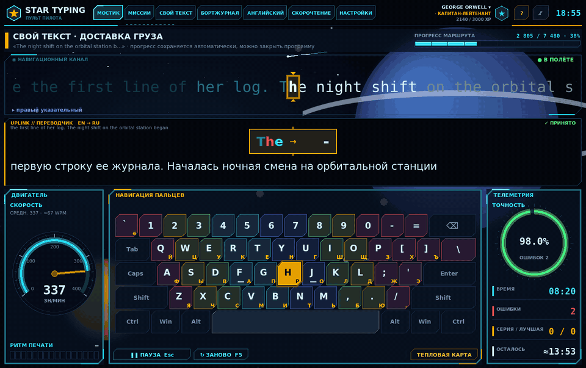
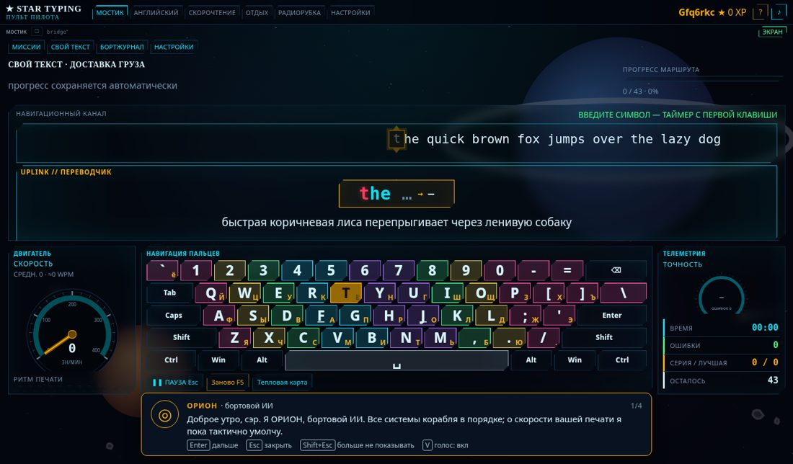
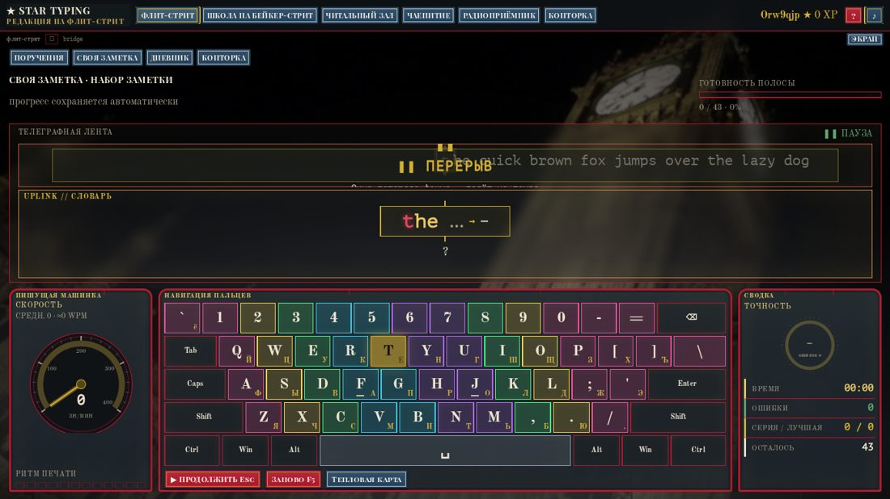
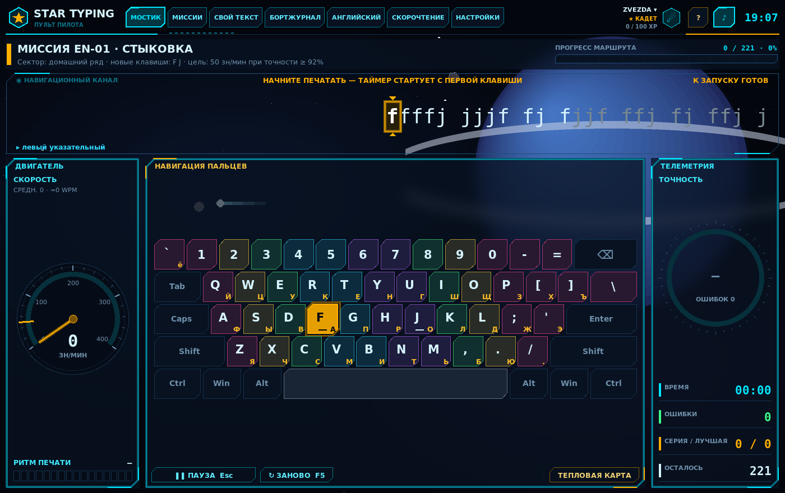
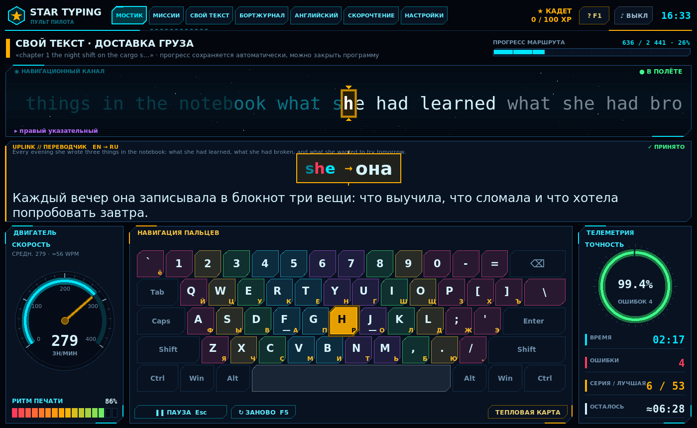
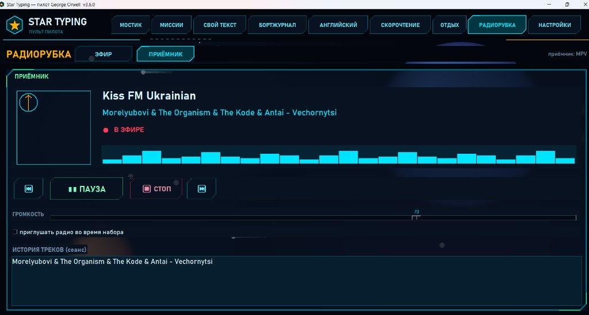
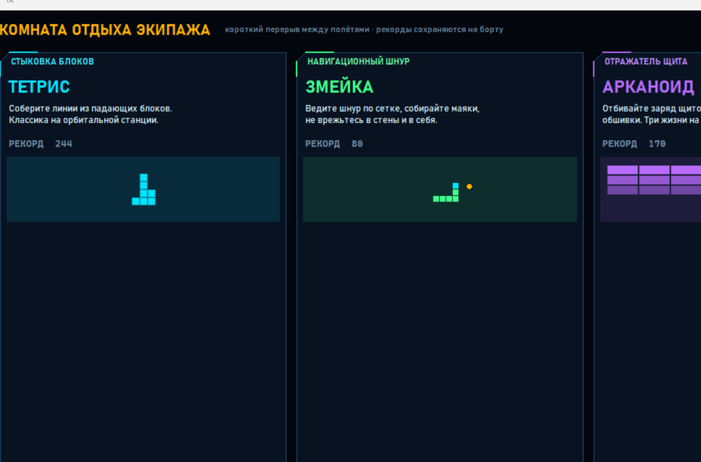
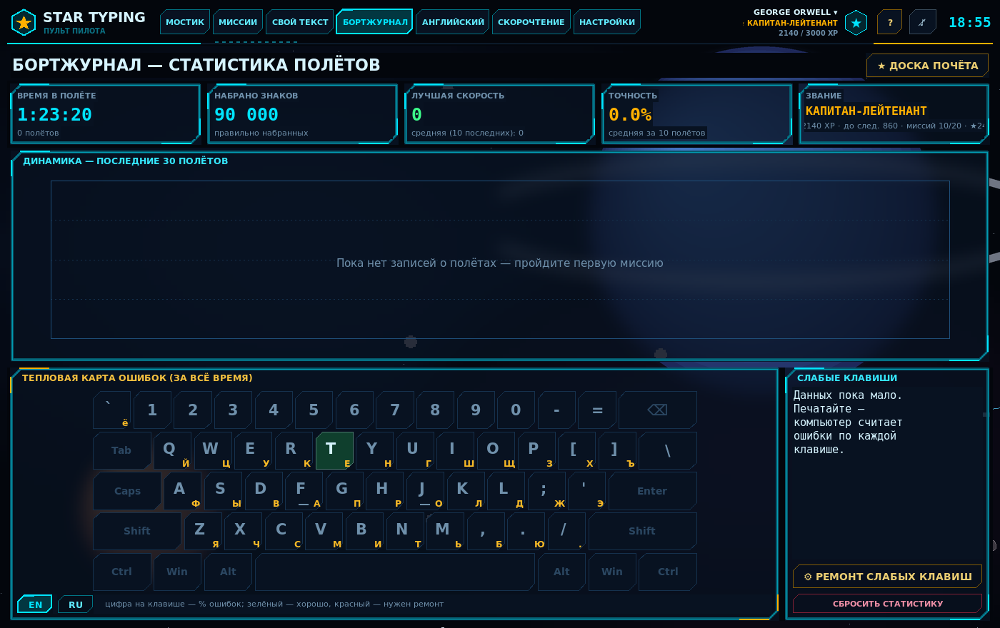

# Star Typing Web — пульт пилота в браузере 🚀

Слепая печать · английский · скорочтение · радио · отдых.  
Интерфейс в стиле космической кабины: стекло, живой космос, прицел набора.



**Репозиторий:** [Teslyar75/Wed_Star_Typing_Version](https://github.com/Teslyar75/Wed_Star_Typing_Version)

Откройте в Chrome или Edge — без установки Python.

---

## Быстрый старт

### Ярлык на рабочий стол (Windows + Docker)

1. **Docker Desktop** установлен и может быть уже запущен (зелёный статус).
2. Ярлык **Star Typing Web** на рабочем столе → двойной клик → контейнеры + браузер на http://localhost.  
   Создать ярлык заново: `install-desktop-shortcut.bat`
3. Скрипт: `start-star-typing-web.bat` (без полной пересборки при каждом старте). Пересборка: `start-star-typing-web.bat /rebuild`.

Нужно: Docker Desktop; порт **80** свободен.

### Обновления (GitHub Releases)

В приложении: баннер при новой версии и блок **Настройки → Ещё → Обновления** (changelog + ссылка на Release).  
Образ Docker **не** тянется сам — обновите через ярлык или:

```bat
start-star-typing-web.bat /rebuild
```

Релиз разработчику: bump `frontend/package.json` + `CHANGELOG.md`, затем `git tag v0.2.0 && git push origin v0.2.0` (Actions создаст Release).

### Docker вручную

```bash
git clone https://github.com/Teslyar75/Wed_Star_Typing_Version.git
cd Wed_Star_Typing_Version
docker compose up --build
```

| | |
| --- | --- |
| UI | http://localhost |
| API | http://localhost/api/health → `{"ok":true}` |

Прод с HTTPS (Let's Encrypt):

```bash
export DOMAIN=star.example.com
export ACME_EMAIL=you@example.com
docker compose up --build -d
```

### Разработка без Docker

**API**

```bash
cd backend
python -m venv .venv
# Windows: .\.venv\Scripts\Activate.ps1
# Linux/macOS: source .venv/bin/activate
pip install -r requirements.txt
pytest -q
uvicorn app.main:app --reload --port 8000
```

**UI**

```bash
cd frontend
npm install
npm run fetch:vosk    # опционально, ~40 MB модель распознавания речи
npm run dev
```

| | |
| --- | --- |
| UI | http://localhost:5173 |
| API | http://localhost:8000/api/health |

```bash
cd frontend && npm test
cd frontend && npm run lighthouse:pwa   # цель ≥ 90
```

---

## Что умеет

| Зона | Возможности |
| --- | --- |
| **Мостик** | Набор через прицел, скорость и точность, UPLINK-перевод, миссии ★★★, ремонт слабых клавиш |
| **Свой текст** | TXT / PDF / вставка → печать с сохранением позиции |
| **Бортжурнал** | График заходов, тепловая карта ошибок, слабые клавиши с цветом |
| **Английский** | ~20 000 слов, сканер, Vosk в браузере, SM-2, склад, «Из книги» |
| **Скорочтение** | Гипердрайв (RSVP), Книга / 2 языка, Gutenberg + CEFR, Шульте, Горбов, пирамида, вспышка |
| **Радиорубка** | Эфир, приёмник, избранное, приглушение при наборе |
| **Отдых** | Змейка · Тетрис · Арканоид |
| **Настройки** | Системы кабины, скины, экипаж (пилоты, PIN, доска почёта, `.stpilot`) |

**Навигация:** шесть зон в шапке (Ctrl+1…6). Миссии, свой текст и бортжурнал — подменю Мостика. Крошки пути с копируемым slug.

**Стек:** React + TypeScript (Vite) · FastAPI · Postgres/SQLite · Caddy · PWA · Web Audio / Canvas космос · vosk-browser.

---

## Новое (октябрь 2026)

- **Гид ОРИОН** — бортовой разум: диалоги на старте и в зонах, звание / рекорд / перерыв / ошибки; вкладка «Гид» в Настройках.
- **Шутки Ориона** — иногда сам прерывает тишину или приглушает радио (~раз в 10 мин); **Enter** — слушать, **Esc** — не сейчас.
- **Вызов Ориона** — кнопка **ОРИОН**, **Home** или палитра: слушает RU («дай шутку» / «смени волну»); радио молчит до конца диалога.
- **СЛАЙДЫ** — кнопка рядом с **ЭКРАН**: ← → волна, ↑ ↓ громкость, M — mute; после выхода масштаб UI сохраняется.
- **Скин «Старая Англия»** — туман, слайдшоу, радио, своя лексика (Звездолёт по умолчанию).
- **Интерфейс на українській и Deutsch.**

| Гид | Старая Англия |
| --- | --- |
|  |  |

Подробно: [docs/FEATURES_2026-10.md](docs/FEATURES_2026-10.md) · видение гида: [docs/ORION_VISION.md](docs/ORION_VISION.md) · онлайн-хостинг (Pages + API): [docs/HOSTING_GITHUB_PAGES.md](docs/HOSTING_GITHUB_PAGES.md) · стоимость (UA): [docs/HOSTING_COST_UA.md](docs/HOSTING_COST_UA.md) · скриншоты: [docs/showcase/new/](docs/showcase/new/)

---

## Экраны

| Добро пожаловать | Мостик |
| --- | --- |
|  |  |



| Английский | Скорочтение |
| --- | --- |
|  |  |

| Радиорубка | Отдых |
| --- | --- |
|  |  |



---

## Зачем веб

- Запуск с любого компьютера в браузере (и как PWA).
- Один сервер на экипаж: прогресс пилотов, тексты, перевод-кэш.
- Docker Compose поднимает UI + API + БД + Caddy за одну команду.
- HTTPS из коробки через Caddy и Let's Encrypt.
- Распознавание речи локально в браузере (модель кэшируется).

---

## Структура репозитория

```
frontend/          # Vite + React + TypeScript
backend/           # FastAPI + SQLAlchemy + Alembic
packages/themes/   # JSON-скины
docs/              # changelog, showcase
docker-compose.yml
Caddyfile
```

## Документация

| Документ | Содержание |
| --- | --- |
| [docs/ORION_VISION.md](docs/ORION_VISION.md) | Орион: сделано, цель, подписка на ИИ-агента |
| [docs/FEATURES_2026-10.md](docs/FEATURES_2026-10.md) | Новое за октябрь 2026 |
| [docs/HOSTING_GITHUB_PAGES.md](docs/HOSTING_GITHUB_PAGES.md) | Онлайн: GitHub Pages + отдельный API |
| [docs/HOSTING_COST_UA.md](docs/HOSTING_COST_UA.md) | Стоимость хостинга для Украины (год) |
| [docs/CHANGELOG_2026-10-14.md](docs/CHANGELOG_2026-10-14.md) | Недавние изменения UI и навигации |
| [docs/showcase/](docs/showcase/) | Гифка и скрины |

Статус продукта (фазы 0–8, Excellence W0–P8): ✅ в проде.

## Вдохновение

- **Слепая печать.** На создание тренажёра вдохновили программы вроде «Стамины» (Stamina) —
  название упомянуто здесь только с благодарностью, код и материалы у нас свои.
- **Английский по карточкам** — давно известная практика, но конкретно здесь вдохновил
  Богдан Стащук — подробнее в разделе [«Благодарности / Идея»](#благодарности--идея) ниже.
- **Скорочтение.** Интерфейс этой части фактически стал шаблоном для множества похожих программ;
  кого благодарить за саму идею, автор пока не знает — если подскажете, с радостью добавим.

## Благодарности / Идея

Идею модуля английского подсказал **Богдан Стащук (Bogdan Stashchuk)** — автор
[YouTube-канала](https://www.youtube.com/@Bogdan_Stashchuk) и
[курсов по программированию на Udemy](https://www.udemy.com/user/bogdanstashchuk/), а также
проекта [bsmarted.com](https://bsmarted.com/). Спасибо за вдохновение!

Реализация, дизайн, код и данные здесь — наши собственные: словарь собран из открытых
источников, никакие материалы bsmarted.com не используются. Программ такого рода много;
эта — личный вариант, встроенный в тренажёр печати Star Typing.

---

*Star Typing Web — браузерный пульт. Родственная настольная сборка: [My_Stamina](https://github.com/Teslyar75/My_Stamina).*
