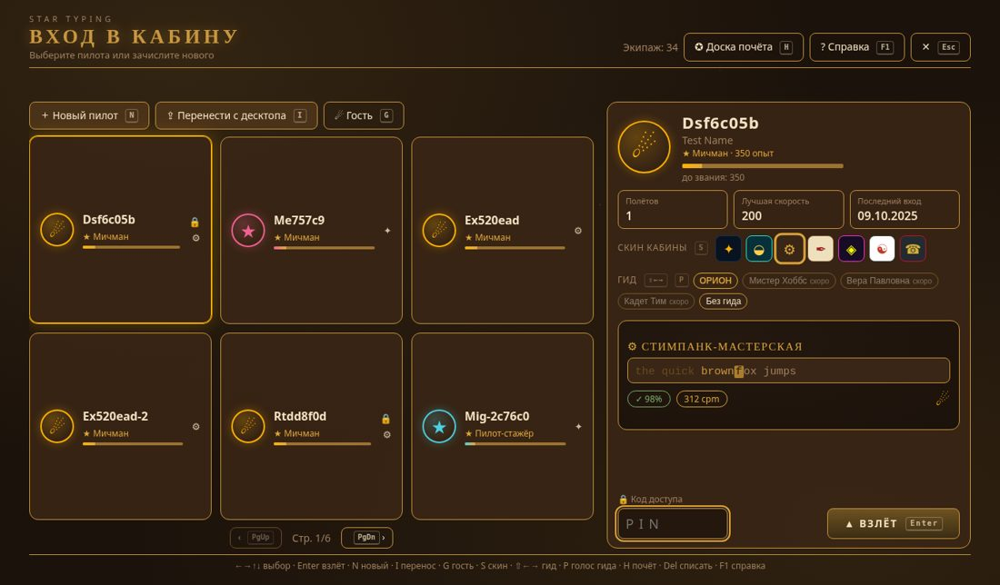
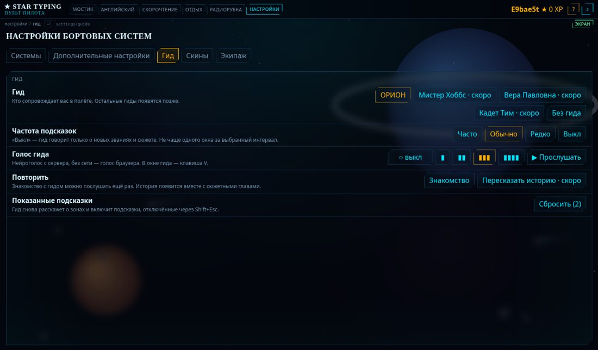
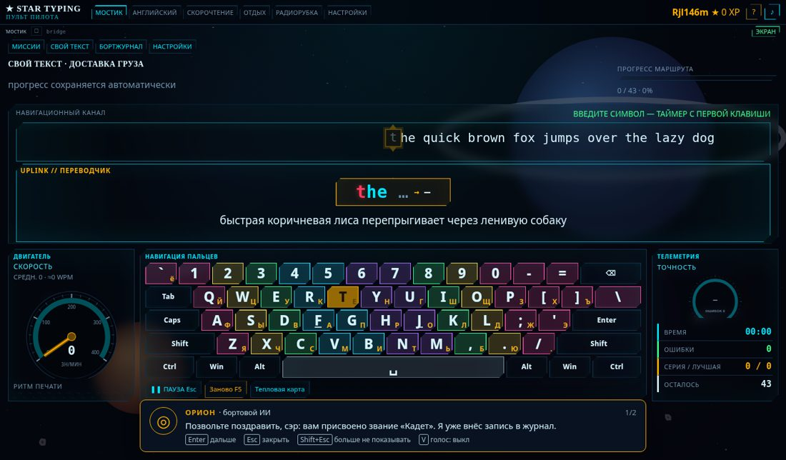
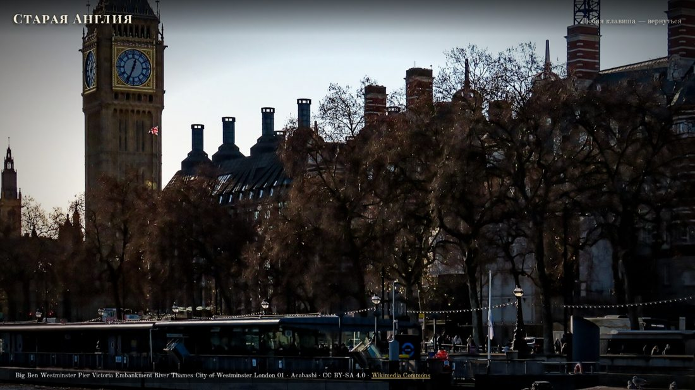
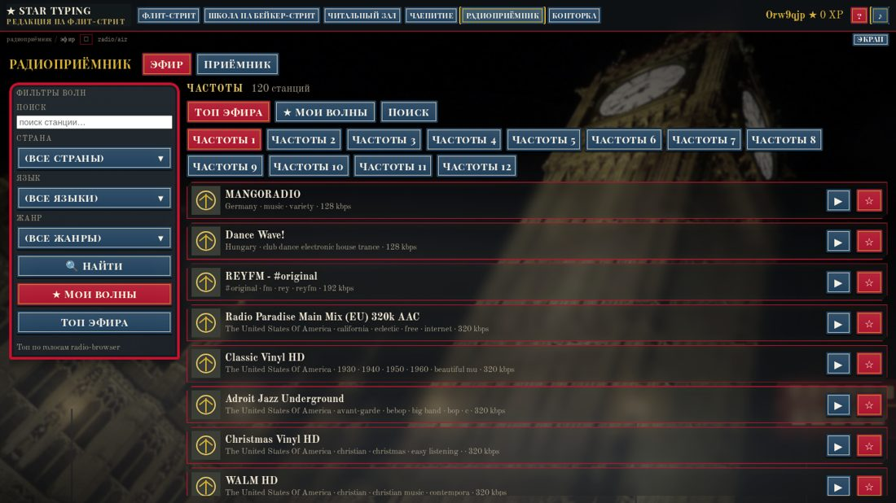
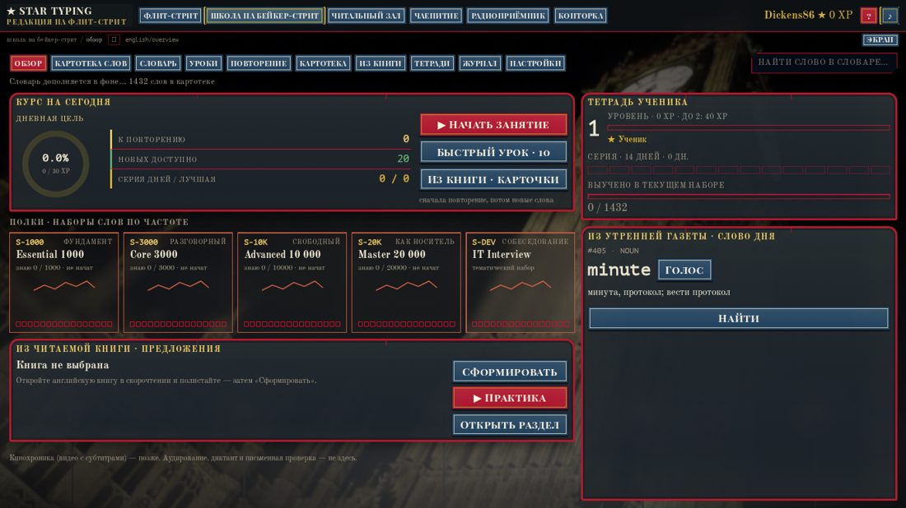
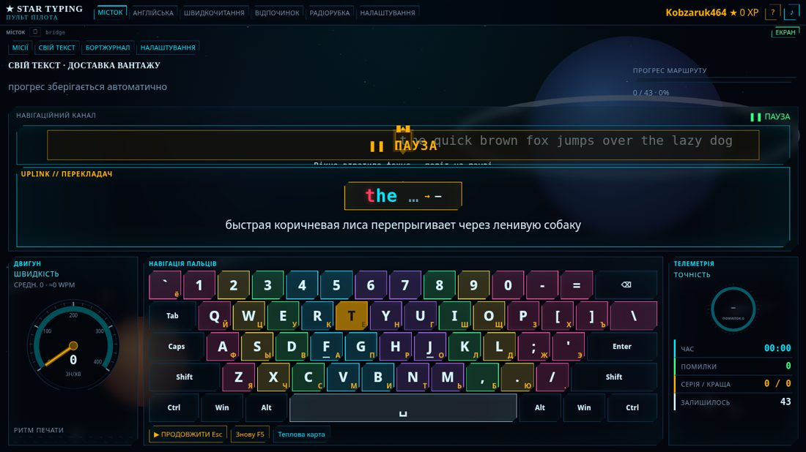
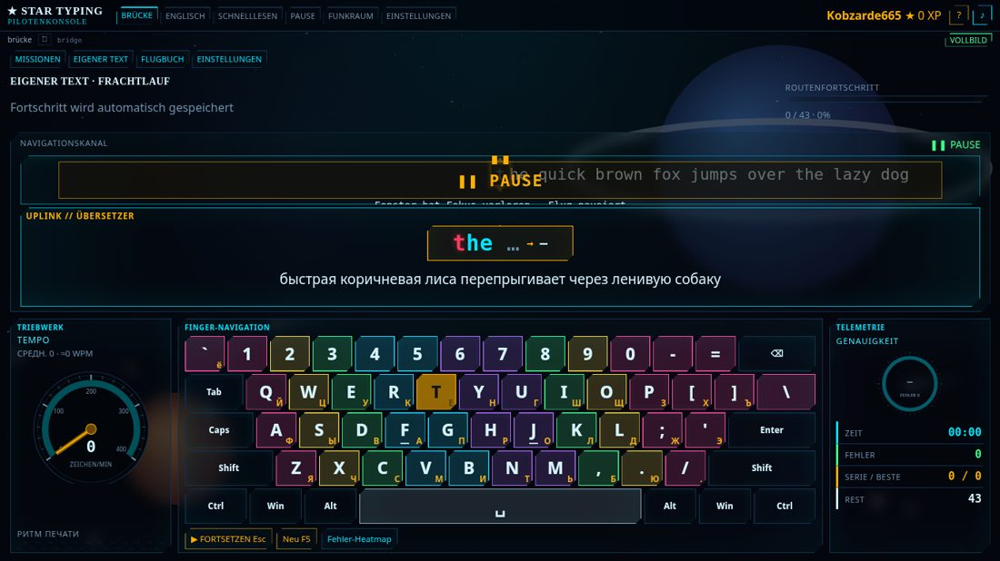

# Новые возможности — октябрь 2026 (веб)

Все скриншоты: [docs/showcase/new/](showcase/new/)

## История пилота
Пилот прочитал книгу и окружил себя её миром — так появляются скины. Звездолёт остаётся основным скином по умолчанию; другие скины — миры прочитанных книг. Историю рассказывает гид в коротких диалогах.

### Гид ОРИОН — бортовой разум, который рассказывает историю
- На стартовом окне можно **выбрать гида** (или отказаться от него).
- ОРИОН — вежливый бортовой дворецкий с сухой британской иронией, обращается к пилоту «сэр». Голос — `ru-RU-DmitryNeural`. Титул: **бортовой разум**.
- История подаётся **короткими диалогами**: первое знакомство, приветствия при входе в каждую зону, реплики на события — **новое звание, личный рекорд, возвращение после перерыва, серия ошибок**.
- **Шутки:** иногда сам прерывает тишину или приглушает радио (~раз в 10 мин); Enter — слушать, Esc — не сейчас. Настройки → «Гид» → шутки вкл/выкл.
- **Кнопка ОРИОН** рядом с СЛАЙДЫ / ЭКРАН: *«Да, я тут…»* → микрофон → «дай шутку» / «смени волну».
- В Настройках вкладка **«Гид»**: выбрать или выключить гида, повторить знакомство, шутки, голос. Состояние — отдельно для каждого пилота.
- Гиды пока только на русском; другие языки — позже.
- **Видение, примеры диалогов, roadmap**: [ORION_VISION.md](ORION_VISION.md).

| Выбор гида | Первый диалог |
| --- | --- |
|  |  |
| **Вкладка «Гид»** | **Реплика на новое звание** |
|  |  |

### Скин «Старая Англия»
Пилот прочитал книгу и окружил себя её миром. Звездолёт остаётся основным скином по умолчанию.
- Лондонский **туман** на фоне, **слайдшоу** викторианских видов в простое, своё **радио** (Wireless).
- Вся космическая лексика заменена: Fleet Street вместо Мостика, Поручения, Дневник, Читальный зал, Чаепитие и т. д.; звания в разделе «Английский» тоже в стиле скина.
- Помещается на маленьких экранах (1280×640) без прокрутки.

| Fleet Street | Слайдшоу |
| --- | --- |
|  |  |
| **Радио (Wireless)** | **Английский в скине** |
|  |  |

### Интерфейс на украинском и немецком
Переведено 452 строки на `uk` и `de`, тест `localeKeys` строго проверяет, что ни один ключ не пропущен. Добавлены недостающие строки скорости, единиц и очереди.

| Українська | Deutsch |
| --- | --- |
|  |  |

## Где что
- Выбор гида — стартовое окно; настройка — Настройки → «Гид». Состояние — localStorage `st_guide::<позывной>`.
- Реплики гида: `packages/guides/ship_ai.json`, `lines/ship_ai.ru.json`.
- Скин — Настройки → Скины. Язык интерфейса — Настройки.
